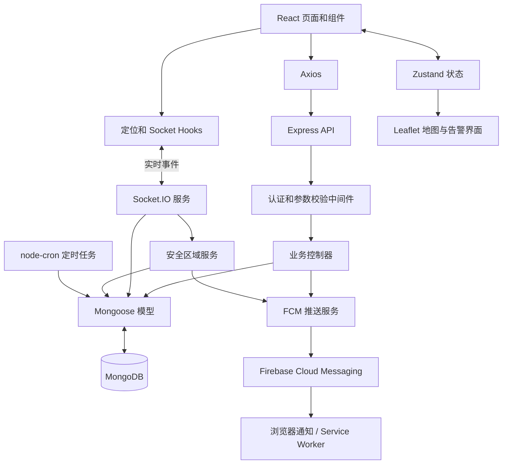
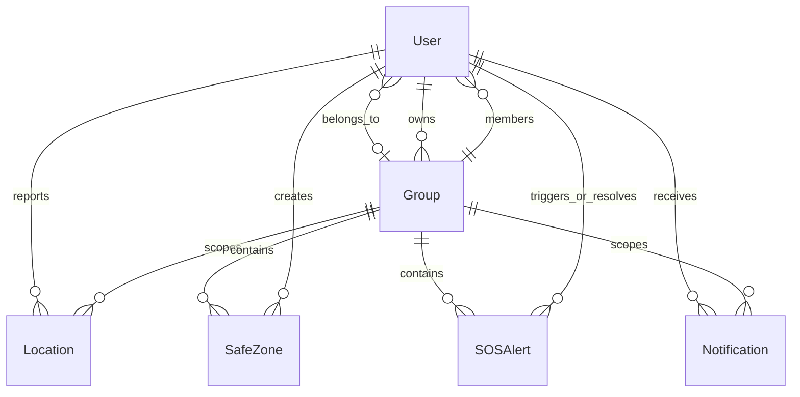
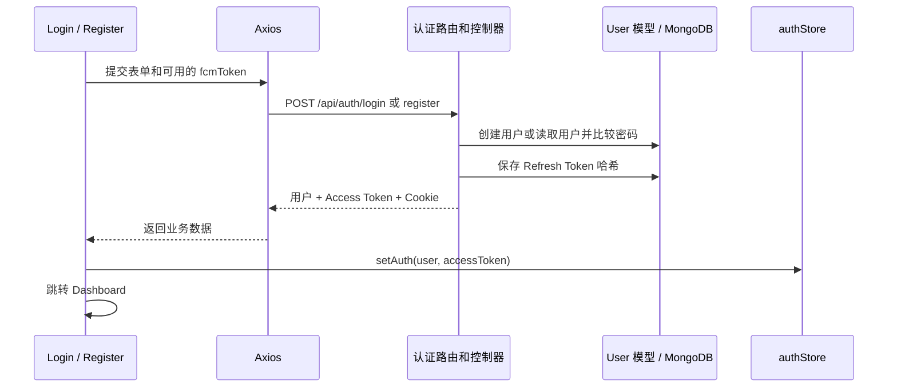
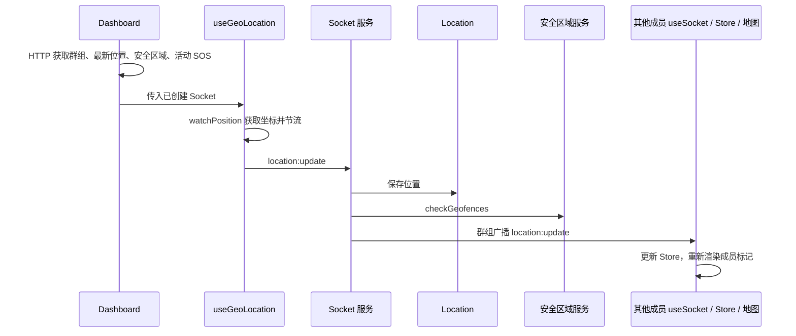
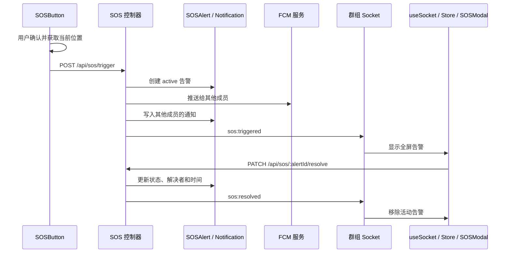

# FSEAS 项目学习指南

本文以当前仓库源码为依据，介绍家庭安全与紧急求助系统（Family Safety & Emergency Alert System）。阅读顺序为：**文件结构与作用 → 技术栈与真实代码 → 核心业务的完整链路**。

代码块均摘自项目真实文件；有些只截取一个函数或局部语句，适合与来源文件对照阅读。本文只介绍已有实现，不包含缺陷评估或改进建议。文件链接均为相对于本文的仓库路径。

目录：

1. [文件夹结构与每个文件的作用](#1-文件夹结构与每个文件的作用)
2. [主要技术栈与真实代码讲解](#2-主要技术栈与真实代码讲解)
3. [核心业务链路](#3-核心业务链路)

## 1. 文件夹结构与每个文件的作用

这是一个前后端放在同一仓库中的项目。`client/` 负责浏览器界面，`server/` 负责接口、实时事件和数据库操作，根目录脚本负责统一启动。

以下列出仓库中的全部项目文件，包括隐藏的配置样例和忽略规则。`.git/` 是 Git 自动管理的版本库，`node_modules/` 是 npm 下载的第三方依赖，按目录说明，不逐个展开内部生成文件。

```text
familySafety_fseas/                      # 项目根目录：统一管理前后端。
├── client/                                                          # 前端工程。
│   ├── public/                                                      # 直接对外提供的静态文件。
│   │   └── firebase-messaging-sw.js                                 # Firebase 后台推送 Service Worker，接收消息并展示系统通知。
│   ├── src/                                                         # 前端业务源码。
│   │   ├── api/                                                     # 统一 HTTP 请求层。
│   │   │   └── axios.js                                             # 创建 HTTP 客户端；附加 Access Token，处理 401 和刷新后的请求重试。
│   │   ├── components/                                              # 按功能划分的界面组件。
│   │   │   ├── Group/                                               # 群组组件。
│   │   │   │   ├── CreateGroup.jsx                                  # 创建群组表单；成功后更新当前用户的 group。
│   │   │   │   ├── JoinGroup.jsx                                    # 邀请码加入表单；成功后更新当前用户的 group。
│   │   │   │   └── MemberList.jsx                                   # 显示成员、最近位置时间和邀请码；复制邀请码、移除成员、退出群组。
│   │   │   ├── Map/                                                 # 地图组件。
│   │   │   │   ├── LiveMap.jsx                                      # 创建 Leaflet 地图和底图图层，提供定位到自己的按钮。
│   │   │   │   ├── MemberMarker.jsx                                 # 根据成员坐标、名字与颜色绘制自定义地图标记和弹出信息。
│   │   │   │   └── SafeZoneCircle.jsx                               # 将安全区域中心和半径绘制成地图圆圈，并显示名称。
│   │   │   ├── Notification/                                        # 通知组件。
│   │   │   │   └── NotificationBell.jsx                             # 根据通知状态计算未读数，显示铃铛和通知页链接。
│   │   │   ├── SOS/                                                 # 求助与告警组件。
│   │   │   │   ├── SOSButton.jsx                                    # 确认求助后获取当前坐标，调用 SOS 触发接口。
│   │   │   │   └── SOSModal.jsx                                     # 展示活动 SOS，提供 Google Maps 坐标链接与解除告警操作。
│   │   │   ├── SafeZone/                                            # 安全区域组件。
│   │   │   │   ├── SafeZoneForm.jsx                                 # 填写区域名称、经纬度和半径，可用当前位置填充坐标并提交创建。
│   │   │   │   └── SafeZoneList.jsx                                 # 展示已保存安全区域；群主可删除区域并更新本地状态。
│   │   │   └── shared/                                              # 通用界面和路由组件。
│   │   │       ├── Navbar.jsx                                       # 导航、当前用户信息、管理员入口、通知铃铛和退出登录。
│   │   │       ├── ProtectedRoute.jsx                               # 等待登录态初始化；有用户则渲染子路由，否则跳转登录页。
│   │   │       └── Spinner.jsx                                      # 可复用的加载动画组件。
│   │   ├── hooks/                                                   # 可复用的状态、副作用和外部服务逻辑。
│   │   │   ├── useFCM.js                                            # 初始化 Firebase，申请通知权限、获取 FCM Token、监听前台消息。
│   │   │   ├── useGeoLocation.js                                    # 持续监听位置，按登录/群组/共享状态决定是否上报，并做 10 秒节流。
│   │   │   └── useSocket.js                                         # 建立带 JWT 的 Socket.IO 连接，监听群组事件并更新状态和提示。
│   │   ├── pages/                                                   # 页面级组件。
│   │   │   ├── Admin.jsx                                            # 管理员页面，加载用户和群组列表，提供删除用户操作。
│   │   │   ├── Dashboard.jsx                                        # 实时地图主页面，加载群组/位置/安全区域/SOS，挂载定位与 Socket。
│   │   │   ├── History.jsx                                          # 选择群组成员，查询并用时间线展示位置历史。
│   │   │   ├── Home.jsx                                             # 产品首页，展示项目能力与进入应用的入口。
│   │   │   ├── Login.jsx                                            # 登录表单，提交账号密码和 FCM Token，保存登录态并跳转。
│   │   │   ├── Notifications.jsx                                    # 加载个人通知，查看时标记已读，并渲染通知列表。
│   │   │   ├── Register.jsx                                         # 注册表单，提交用户信息，保存注册后的登录态并跳转。
│   │   │   ├── SafeZones.jsx                                        # 组合安全区域列表与创建表单，提供管理页面。
│   │   │   └── Settings.jsx                                         # 编辑显示名称和位置共享开关，保存后更新用户状态。
│   │   ├── store/                                                   # 跨组件共享的应用状态。
│   │   │   ├── authStore.js                                         # 保存用户、Access Token、登录和加载状态；提供登录态更新方法。
│   │   │   └── groupStore.js                                        # 保存群组、成员位置、安全区域、活动 SOS 和通知；提供状态更新方法。
│   │   ├── utils/                                                   # 前端工具函数。
│   │   │   ├── formatDate.js                                        # 用 date-fns 格式化日期，以及生成距离现在多久的文本。
│   │   │   └── haversine.js                                         # 提供两组经纬度之间球面距离的 Haversine 计算函数。
│   │   ├── App.jsx                                                  # 定义页面路由、初始化登录态，并挂载导航栏与 Toast 容器。
│   │   ├── index.css                                                # 引入 Tailwind 各层样式，设置 body 的全局外观。
│   │   └── main.jsx                                                 # 挂载 React 根组件、导入样式、注册 Firebase Service Worker。
│   ├── .env.example                                                 # 前端环境变量样例：API、Socket、Firebase 等配置项。
│   ├── .gitignore                                                   # 忽略前端依赖、构建输出、本地环境配置等文件。
│   ├── index.html                                                   # 前端 HTML 入口；提供 root 容器并加载 main.jsx。
│   ├── package-lock.json                                            # 锁定前端依赖的具体版本和完整依赖关系。
│   ├── package.json                                                 # 前端依赖清单，以及 dev/build/lint/preview 命令。
│   ├── postcss.config.js                                            # 配置 Tailwind CSS 和 Autoprefixer 的 CSS 处理流程。
│   ├── tailwind.config.js                                           # 声明扫描路径，并扩展 danger、darkbg 等主题颜色。
│   ├── vercel.json                                                  # 将前端路由请求重写到 index.html，支持 SPA 页面直达。
│   └── vite.config.js                                               # 启用 React 插件，配置开发服务端口 5173 和网络监听。
├── server/                                                          # 后端工程。
│   ├── src/                                                         # 后端业务源码。
│   │   ├── config/                                                  # 外部服务连接与初始化。
│   │   │   ├── db.js                                                # 读取 MONGODB_URI 并通过 Mongoose 建立数据库连接。
│   │   │   └── firebase.js                                          # 解析服务账号配置，初始化 Firebase Admin SDK 并导出实例。
│   │   ├── controllers/                                             # HTTP 业务处理。
│   │   │   ├── admin.controller.js                                  # 查询系统用户/群组，删除用户并处理其群组关联数据与实时通知。
│   │   │   ├── auth.controller.js                                   # 实现认证与双 Token 签发/刷新、用户资料更新和位置共享变更广播。
│   │   │   ├── group.controller.js                                  # 实现群组生命周期、成员关系维护及对应实时事件。
│   │   │   ├── location.controller.js                               # 保存 REST 位置上报、查询成员历史、聚合群组最新位置。
│   │   │   ├── notification.controller.js                           # 查询当前用户最近 50 条通知，并将其未读通知批量设为已读。
│   │   │   ├── safezone.controller.js                               # 创建、查询、修改和删除当前群组的安全区域。
│   │   │   └── sos.controller.js                                    # 保存和解除 SOS、查询告警、写通知、调用推送并广播事件。
│   │   ├── jobs/                                                    # 后台定时任务。
│   │   │   └── purgeLocations.job.js                                # 注册每日午夜的定时任务，删除超过 7 天的位置记录。
│   │   ├── middleware/                                              # 请求处理链中的公共检查和错误处理。
│   │   │   ├── auth.middleware.js                                   # JWT 验证、角色授权、群主权限检查，向请求附加 user/group。
│   │   │   ├── error.middleware.js                                  # 接收异常并输出统一错误 JSON，开发模式下附加日志和堆栈。
│   │   │   └── validate.middleware.js                               # 收集 express-validator 校验结果，有错误时抛出统一 API 异常。
│   │   ├── models/                                                  # 数据库文档结构及模型方法。
│   │   │   ├── Group.model.js                                       # 群组模型，含群主、成员引用和随机生成的 8 位邀请码。
│   │   │   ├── Location.model.js                                    # 位置模型，含用户/群组/坐标/精度/时间，定义 7 天 TTL 和查询索引。
│   │   │   ├── Notification.model.js                                # 通知模型，含接收者、类型、标题、正文、元数据和已读状态。
│   │   │   ├── SOSAlert.model.js                                    # SOS 模型，含触发者、位置、活动/已解决状态及解决者和时间。
│   │   │   ├── SafeZone.model.js                                    # 安全区域模型，含群组、创建者、中心坐标和米制半径。
│   │   │   └── User.model.js                                        # 用户模型，含角色、群组、FCM Token、共享状态和密码哈希逻辑。
│   │   ├── routes/                                                  # URL、HTTP 方法与处理函数的映射。
│   │   │   ├── admin.routes.js                                      # 管理员路由；验证 admin 角色后提供用户/群组查询和用户删除。
│   │   │   ├── auth.routes.js                                       # 认证路由：注册、登录、退出、刷新 Token、资料读取和更新。
│   │   │   ├── group.routes.js                                      # 群组路由：创建、加入、读取、退出、移除成员及相关校验。
│   │   │   ├── location.routes.js                                   # 位置路由：REST 上报、成员历史、群组各成员最新位置。
│   │   │   ├── notification.routes.js                               # 个人通知查询与批量标记已读路由。
│   │   │   ├── safezone.routes.js                                   # 安全区域路由；配置群主权限、名称/坐标/半径校验及增改查删。
│   │   │   └── sos.routes.js                                        # SOS 路由：触发、解除、读取活动告警和历史记录。
│   │   ├── services/                                                # 安全区域与推送等业务服务。
│   │   │   ├── fcm.service.js                                       # 封装单设备和多设备 FCM 推送，转换数据字段并分别处理发送结果。
│   │   │   └── geofence.service.js                                  # 计算位置与安全区域距离，记录内外状态并在边界变化时通知群组。
│   │   ├── sockets/                                                 # 实时连接和事件处理。
│   │   │   └── socket.handler.js                                    # Socket JWT 验证、用户/群组房间管理、位置上报、共享切换和平安签到。
│   │   ├── utils/                                                   # 响应和异常等通用工具。
│   │   │   ├── ApiError.js                                          # 带 HTTP 状态码及错误详情的异常类。
│   │   │   ├── ApiResponse.js                                       # 统一成功响应结构为 success/message/data。
│   │   │   └── asyncHandler.js                                      # 捕获异步控制器的 Promise 异常并传给 Express 错误处理器。
│   │   └── app.js                                                   # 组装 Express 应用、中间件、健康检查、API 路由和统一错误处理。
│   ├── .env.example                                                 # 后端环境变量样例：端口、数据库、JWT、Firebase、跨域来源等。
│   ├── .gitignore                                                   # 忽略后端 node_modules、环境变量文件和日志。
│   ├── package-lock.json                                            # 锁定后端依赖版本和完整依赖关系。
│   ├── package.json                                                 # 后端依赖和 start/dev 命令；使用 ES Modules。
│   └── server.js                                                    # 后端启动入口；创建 HTTP/Socket 服务，连接数据库并初始化 Firebase 和定时任务。
├── PROJECT_GUIDE.md                                                 # 本文：项目文件、技术栈实例和端到端业务链路学习指南。
├── README.md                                                        # 项目概述、功能说明、环境要求和启动步骤。
├── package-lock.json                                                # 锁定根目录依赖的具体版本和依赖关系。
└── package.json                                                     # 根目录 npm 脚本；使用 concurrently 同时启动前后端。
```

补充目录：根目录和两端的 `node_modules/`（安装依赖后生成）保存第三方包；根目录 `.git/` 保存提交、分支和索引。前端执行构建后，`client/dist/` 保存可部署的 HTML、CSS 和 JavaScript 产物。

### 1.1 先理解各层的边界

| 层 | 回答的问题 | 项目中的例子 |
|---|---|---|
| pages | 用户正在使用哪个完整页面？ | `Dashboard.jsx` |
| components | 页面由哪些界面块组成？ | `LiveMap.jsx`、`SOSButton.jsx` |
| hooks | 如何接入持续发生的外部事件？ | `useGeoLocation.js`、`useSocket.js` |
| store | 多个组件共享什么状态？ | `groupStore.js` |
| api | 如何统一发送 HTTP 请求？ | `axios.js` |
| routes | 什么 URL 和 HTTP 方法调用哪个函数？ | `sos.routes.js` |
| middleware | 请求能否继续，输入是否有效？ | `auth.middleware.js` |
| controllers | 一次 HTTP 请求要完成哪些业务操作？ | `sos.controller.js` |
| services | 哪些业务能力可由不同入口调用？ | `geofence.service.js` |
| models | 保存什么数据，用什么规则和引用关系？ | `Location.model.js` |
| sockets | 收到实时事件后如何保存、处理、广播？ | `socket.handler.js` |

## 2. 主要技术栈与真实代码讲解

### 2.1 整体技术架构

项目采用 MERN：**MongoDB + Express + React + Node.js**，并通过 Socket.IO 和 Firebase 支持实时更新与推送。它是浏览器中的单页应用（SPA），界面导航由前端路由控制。



以下版本按 `package.json` 的主要版本说明；精确安装版本由各自的 `package-lock.json` 锁定。

| 技术 | 主要版本或形式 | 作用 | 实际入口 |
|---|---|---|---|
| JavaScript / JSX / ES Modules | `.js`、`.jsx`、`import/export` | 前后端代码语言和模块组织 | `main.jsx`、`server.js` |
| React / React DOM | 18 | 组件、状态、生命周期、DOM 挂载 | `client/src/main.jsx` |
| React Router | 6 | URL 导航与页面权限入口 | `App.jsx` |
| Zustand | 4 | 登录态和群组全局状态 | `store/` |
| Axios | 1 | API 请求、拦截器、自动刷新 | `api/axios.js` |
| Tailwind CSS / PostCSS / Autoprefixer | Tailwind 3、PostCSS 8 | 样式工具类及构建处理 | `index.css`、配置文件 |
| Vite / React 插件 | Vite 5 | 前端开发服务和生产构建 | `vite.config.js` |
| Leaflet / React Leaflet | Leaflet 1、React Leaflet 4 | 地图、标记、安全区域圆圈 | `components/Map/` |
| 浏览器 Geolocation API | 浏览器原生 API | 获取当前位置和持续位置变化 | `useGeoLocation.js` |
| Socket.IO / socket.io-client | 4 | 实时双向事件、按群组广播 | 两端 Socket 文件 |
| Node.js / Express | Express 4 | HTTP 服务和 API 路由 | `server.js`、`app.js` |
| MongoDB / Mongoose | Mongoose 8 | 文档存储、引用、查询与索引 | `models/` |
| jsonwebtoken / bcryptjs | 9 / 2 | JWT 签发验证、密码与刷新令牌哈希 | 认证控制器和用户模型 |
| Firebase / firebase-admin | 10 / 12 | 浏览器和服务器推送接入 | `useFCM.js`、`fcm.service.js` |
| Service Worker | 浏览器原生能力 | 后台消息接收与系统通知 | `firebase-messaging-sw.js` |
| express-validator | 7 | HTTP 参数校验 | `routes/` |
| Helmet / cors / cookie-parser / Morgan | 后端中间件 | 响应头、跨域、Cookie 解析、开发日志 | `app.js` |
| node-cron | 3 | 每日清理位置数据 | `purgeLocations.job.js` |
| date-fns / react-hot-toast | 3 / 2 | 日期文本和即时提示 | `formatDate.js`、`App.jsx` |
| dotenv / nodemon / concurrently | 工程工具 | 环境变量、后端重启、同时启动两端 | 后端入口和 npm 脚本 |
| ESLint | 8 | 前端静态代码检查命令 | `client/package.json` |
| Vercel 重写配置 | JSON | SPA 页面路径回退至 HTML 入口 | `client/vercel.json` |

下面逐项通过代码说明这些技术在项目中的具体使用。

### 2.2 JavaScript 模块与 Node.js：后端启动入口

来源：[server/server.js](server/server.js)

```javascript
import 'dotenv/config';
import http from 'http';
import { Server } from 'socket.io';
import app from './src/app.js';
import connectDB from './src/config/db.js';
import { initFirebase } from './src/config/firebase.js';
import initSocketHandlers from './src/sockets/socket.handler.js';
import { startLocationPurgeJob } from './src/jobs/purgeLocations.job.js';
```

- `import 'dotenv/config'` 是只为执行初始化的导入，让 `.env` 中的配置进入 `process.env`。
- `http` 是 Node.js 内置模块；`socket.io` 是第三方包；`./src/app.js` 等是本地模块。
- 两端 `package.json` 使用 `"type": "module"`，后端因此可以直接采用 `import/export`。
- `app` 是 Express 应用，入口文件负责把它连接到真正监听端口的 HTTP 服务。数据库、Firebase、定时任务分别由独立模块初始化，职责更容易找到。

来源：[server/server.js](server/server.js)

```javascript
// Create HTTP server wrapping Express app
const server = http.createServer(app);

// Initialize Socket.io
export const io = new Server(server, {
  cors: {
    origin: process.env.CLIENT_ORIGIN || 'http://localhost:5173',
    credentials: true,
  },
});

// Setup socket logic
initSocketHandlers(io);
```

`http.createServer(app)` 让 HTTP API 和 Socket.IO 共用一个服务器。`new Server(server, ...)` 挂载实时通信，`initSocketHandlers(io)` 注册事件处理。文件后半段的 `startServer()` 依次连接数据库、初始化 Firebase、注册清理任务，最后调用 `server.listen(PORT)`；默认端口是 5000。

### 2.3 React：组件、Props、State 和 Effect

来源：[client/src/main.jsx](client/src/main.jsx)

```javascript
ReactDOM.createRoot(document.getElementById('root')).render(
  <React.StrictMode>
    <App />
  </React.StrictMode>,
);
```

`createRoot` 找到 `index.html` 中的 `root` 节点，把 `<App />` 渲染到页面。JSX 的 `<App />` 表示组件调用；`React.StrictMode` 包裹应用，帮助开发期间检查组件行为。

来源：[client/src/pages/Dashboard.jsx](client/src/pages/Dashboard.jsx)

```javascript
  // Fetch initial data
  useEffect(() => {
    const fetchDashboardData = async () => {
      if (!user?.group) {
        setLoading(false);
        return;
      }

      try {
        const [groupRes, locRes, szRes, sosRes] = await Promise.all([
          api.get('/groups/mine'),
          api.get('/locations/latest'),
          api.get('/safezones'),
          api.get('/sos/active')
        ]);

        setGroup(groupRes.data.data.group);
        setAllLocations(locRes.data.data.locations || []);
        setSafeZones(szRes.data.data.safeZones || []);
        setActiveSOSAlerts(sosRes.data.data.activeAlerts || []);
      } catch (err) {
        console.error('Failed to fetch dashboard data', err);
        // Silently fail or toast
      } finally {
        setLoading(false);
      }
    };

    fetchDashboardData();
  }, [user?.group]);
```

这段是 React 的副作用逻辑：

1. `useEffect` 在组件挂载及依赖 `user?.group` 变化时执行，因此加入群组后会重新加载数据。
2. 没有群组就结束加载；有群组则用 `Promise.all` 同时读取群组、最新位置、安全区域和活动 SOS。
3. `setGroup` 等方法将结果写入 Zustand；订阅这些状态的组件随后重新渲染。
4. `setLoading(false)` 改变组件的局部状态，让页面从加载动画切换为内容。

`Dashboard.jsx` 使用 `<LiveMap center={mapCenter} zoom={4}>` 传入 Props，再将 `MemberMarker` 和 `SafeZoneCircle` 作为子组件放进地图。这就是“页面组合组件，状态决定界面”的实际例子。

### 2.4 React Router：页面路由与受保护子路由

来源：[client/src/App.jsx](client/src/App.jsx)

```javascript
        {/* Protected Routes */}
        <Route element={<ProtectedRoute />}>
          <Route path="/dashboard" element={<Dashboard />} />
          <Route path="/history" element={<History />} />
          <Route path="/safezones" element={<SafeZones />} />
          <Route path="/notifications" element={<Notifications />} />
          <Route path="/settings" element={<Settings />} />
          <Route path="/admin" element={<Admin />} />
        </Route>
```

`Route` 将 URL 映射到组件，例如 `/dashboard` 对应 `<Dashboard />`。外层无路径的 `Route` 使用 `ProtectedRoute` 包住多个需要登录的页面。

来源：[client/src/components/shared/ProtectedRoute.jsx](client/src/components/shared/ProtectedRoute.jsx)

```javascript
import { Navigate, Outlet } from 'react-router-dom';
import useAuthStore from '../../store/authStore';
import Spinner from './Spinner';

export default function ProtectedRoute() {
  const { user, isLoading } = useAuthStore();

  if (isLoading) {
    return (
      <div className="min-h-screen flex items-center justify-center bg-darkbg">
         <Spinner />
      </div>
    );
  }

  return user ? <Outlet /> : <Navigate to="/login" replace />;
}
```

`isLoading` 为真时先显示加载状态；有 `user` 时用 `Outlet` 渲染当前匹配的子页面；没有用户则通过 `Navigate` 跳转 `/login`。这段代码控制前端页面入口。后端 API 另由 JWT 和角色中间件检查访问权限。`Login.jsx` 中的 `navigate('/dashboard')` 则实现登录成功后的程序式导航。

### 2.5 Zustand：跨组件共享状态

来源：[client/src/store/groupStore.js](client/src/store/groupStore.js)

```javascript
  updateMemberLocation: (userId, locationData) =>
    set((state) => ({
      locations: {
        ...state.locations,
        [userId]: locationData,
      },
    })),

  setAllLocations: (locationsArray) =>
    set(() => {
        const locationsMap = {};
        locationsArray.forEach(loc => {
            // Aggregation returns `user` (ObjectId string), socket returns `userId`
            const key = loc.userId || loc.user;
            if (key) locationsMap[key] = loc;
        });
        return { locations: locationsMap };
    }),
```

- `create` 创建一个可以像 Hook 一样调用的全局 Store，组件通过 `useGroupStore()` 读取状态和方法。
- `locations` 使用 `userId → 最新位置` 的对象结构，便于地图通过用户 ID 查找位置。
- `updateMemberLocation` 保留其他成员位置，只替换一个用户的数据。对象展开生成新对象，使订阅者能观察到更新。
- `setAllLocations` 将 HTTP 返回的数组转成相同结构；HTTP 数据字段为 `user`，Socket 数据字段为 `userId`，这里统一两种输入。
- Socket 回调使用 `useGroupStore.getState().updateMemberLocation(...)`，可以在 React 渲染函数之外更新同一个 Store。

`authStore.js` 同样通过 `create` 保存 `user` 和 `accessToken`；`setAuth` 用于登录，`clearAuth` 用于退出，`updateUser` 用于更新资料。

### 2.6 Axios：统一 API 请求与 Token 刷新

来源：[client/src/api/axios.js](client/src/api/axios.js)

```javascript
const api = axios.create({
  baseURL: import.meta.env.VITE_API_URL || 'http://localhost:5000/api',
  withCredentials: true, // Need this to send/receive refresh token in HTTP-only cookie
});
```

`baseURL` 将页面中的 `/auth/login` 等相对路径拼接成后端地址。`withCredentials: true` 允许在符合浏览器 Cookie 规则的请求中携带刷新令牌 Cookie。调用端不必重复配置这些选项。

来源：[client/src/api/axios.js](client/src/api/axios.js)

```javascript
// Request Interceptor: Attach access token
api.interceptors.request.use(
  (config) => {
    const { accessToken } = useAuthStore.getState();
    if (accessToken) {
      config.headers['Authorization'] = `Bearer ${accessToken}`;
    }
    return config;
  },
  (error) => Promise.reject(error)
);
```

请求拦截器在每次发送前读取当前 Access Token，并将它放入 `Authorization: Bearer ...`。这样登录、地图、通知等页面可以共用一个请求客户端。

来源：[client/src/api/axios.js](client/src/api/axios.js)

```javascript
        const { data } = await axios.post(
          `${import.meta.env.VITE_API_URL || 'http://localhost:5000/api'}/auth/refresh`,
          {},
          { withCredentials: true }
        );

        const newAccessToken = data.data.accessToken;

        // Update zustand store state (without triggering a full re-auth check loop)
        const currentStore = useAuthStore.getState();
        currentStore.setAuth(currentStore.user, newAccessToken);

        processQueue(null, newAccessToken);
        originalRequest.headers['Authorization'] = `Bearer ${newAccessToken}`;

        return api(originalRequest);
```

响应拦截器收到符合条件的 401 后，用 Cookie 调用刷新接口，保存新的 Access Token，再重发原请求。文件里的 `_retry` 标记避免同一请求反复重试；`isRefreshing` 和 `failedQueue` 让同时失败的多个请求等待同一次刷新结果。这里直接使用基础 `axios.post` 发起刷新请求，再由封装的 `api` 重试业务请求。

### 2.7 Tailwind CSS、PostCSS 与 Autoprefixer：样式如何生成

来源：[client/tailwind.config.js](client/tailwind.config.js)

```javascript
/** @type {import('tailwindcss').Config} */
export default {
  content: [
    "./index.html",
    "./src/**/*.{js,ts,jsx,tsx}",
  ],
  theme: {
    extend: {
      colors: {
        danger: '#dc2626', // Emergency Red
        darkbg: '#111827', // Dark sidebar background
      }
    },
  },
  plugins: [],
}
```

`content` 告诉 Tailwind 去哪些文件查找类名。`extend.colors` 定义的 `danger` 和 `darkbg` 可以直接写成 `bg-danger`、`text-danger`、`bg-darkbg` 等类。

来源：[client/src/index.css](client/src/index.css)

```css
@tailwind base;
@tailwind components;
@tailwind utilities;

@layer base {
  body {
    @apply antialiased text-white bg-[#111827]; /* Tailwind darkbg */
    margin: 0;
    padding: 0;
    overflow-x: hidden;
  }
}
```

来源：[client/postcss.config.js](client/postcss.config.js)

```javascript
export default {
  plugins: {
    tailwindcss: {},
    autoprefixer: {},
  },
}
```

`@tailwind` 引入基础、组件和工具样式；`@apply` 在全局 body 样式中复用工具类。PostCSS 执行 Tailwind 插件和 Autoprefixer。页面里的 `flex`、`p-6`、`md:flex-row` 分别表示弹性布局、间距和中等屏幕以上的横向布局。

### 2.8 Vite：React 开发与构建

来源：[client/vite.config.js](client/vite.config.js)

```javascript
import { defineConfig } from 'vite';
import react from '@vitejs/plugin-react';

export default defineConfig({
  plugins: [react()],
  server: {
    port: 5173,
    host: true,
    // Add proxy if needed, though we use VITE_API_URL env var and CORS
  },
});
```

`react()` 插件负责 React/JSX 的开发和构建支持。开发服务器使用 5173 端口，`host: true` 开启网络监听。前端代码通过 `import.meta.env.VITE_API_URL` 读取 Vite 暴露的配置。`client/package.json` 的 `dev: vite` 启动开发服务，`build: vite build` 生成生产文件，`preview: vite preview` 预览构建结果。

### 2.9 Leaflet 与 React Leaflet：地图、底图、标记和圆圈

来源：[client/src/components/Map/LiveMap.jsx](client/src/components/Map/LiveMap.jsx)

```javascript
      <MapContainer
        center={[center.lat, center.lng]}
        zoom={zoom}
        style={{ width: '100%', height: '100%', background: '#242f3e' }}
        zoomControl={true}
        scrollWheelZoom={true}
      >
        <TileLayer
          attribution='&copy; <a href="https://www.openstreetmap.org/copyright">OpenStreetMap</a> &copy; <a href="https://carto.com/">CARTO</a>'
          url="https://{s}.basemaps.cartocdn.com/dark_all/{z}/{x}/{y}{r}.png"
        />
```

`MapContainer` 创建地图实例，使用 `[纬度, 经度]` 数组设置中心。`TileLayer` 从 CARTO 的地址请求地图瓦片；attribution 保留 OpenStreetMap 和 CARTO 的来源说明。`children` 插入成员标记和安全区域。

来源：[client/src/components/Map/SafeZoneCircle.jsx](client/src/components/Map/SafeZoneCircle.jsx)

```javascript
import { Circle, Popup } from 'react-leaflet';

export default function SafeZoneCircle({ center, radius, name }) {
  return (
    <Circle
      center={[center.lat, center.lng]}
      radius={radius}
      pathOptions={{
        color: '#3b82f6',
        fillColor: '#3b82f6',
        fillOpacity: 0.15,
        weight: 2,
        opacity: 0.7,
      }}
    >
      <Popup>
        <div style={{ color: '#1f2937', fontSize: '13px' }}>
          <p style={{ fontWeight: 700, margin: 0 }}>{name}</p>
          <p style={{ margin: 0, color: '#6b7280' }}>Radius: {radius}m</p>
        </div>
      </Popup>
    </Circle>
  );
}
```

`Circle` 把中心坐标和米制 `radius` 转成地图圆圈；`pathOptions` 控制边线和填充。`Popup` 提供点击后的说明。成员标记由 `MemberMarker.jsx` 的 `Marker` 与 Leaflet `L.divIcon` 绘制。SOS 弹窗还会生成一个 Google Maps 外部链接，让用户查看求助坐标；主地图的实际渲染由 Leaflet 完成。

### 2.10 浏览器定位 API 与自定义 Hook

来源：[client/src/hooks/useGeoLocation.js](client/src/hooks/useGeoLocation.js)

```javascript
    const handleSuccess = (position) => {
      const now = Date.now();

      // Throttle emissions to avoid flooding the server
      if (now - lastEmitRef.current < EMIT_INTERVAL_MS) return;
      lastEmitRef.current = now;

      const payload = {
        lat: position.coords.latitude,
        lng: position.coords.longitude,
        accuracy: position.coords.accuracy,
      };

      // Emit to socket
      socket.emit('location:update', payload);
    };
```

浏览器返回 `position.coords`，代码取出纬度、经度和精度。`lastEmitRef` 记录上次发送时间，两个发送之间至少间隔 10 秒；这是对位置回调进行节流，并不表示每隔 10 秒强制产生一次坐标。最终通过 Socket 发出 `location:update`。

来源：[client/src/hooks/useGeoLocation.js](client/src/hooks/useGeoLocation.js)

```javascript
    // Watch position
    watcherRef.current = navigator.geolocation.watchPosition(handleSuccess, handleError, {
      enableHighAccuracy: true,
      maximumAge: 10000,
      timeout: 15000,
    });

    return () => {
      if (watcherRef.current !== null) {
        navigator.geolocation.clearWatch(watcherRef.current);
        watcherRef.current = null;
      }
    };
  }, [isAuthenticated, userGroup, isLocationSharingOn, socket]);
```

`watchPosition` 持续监听位置变化；`enableHighAccuracy` 请求高精度，`maximumAge` 和 `timeout` 设置缓存和等待时间。Effect 返回的清理函数调用 `clearWatch`，用于停止旧的监听。Effect 前半段检查登录、群组、共享开关和 Socket 是否具备，只有条件满足才开始定位。

### 2.11 Socket.IO：连接、房间和广播

来源：[client/src/hooks/useSocket.js](client/src/hooks/useSocket.js)

```javascript
    // Initialize socket connection
    const newSocket = io(import.meta.env.VITE_SOCKET_URL || 'http://localhost:5000', {
      auth: { token: accessToken },
      withCredentials: true,
      reconnection: true,
      reconnectionAttempts: 10,
      reconnectionDelay: 2000,
    });

    socketRef.current = newSocket;
    setSocket(newSocket); // Trigger re-render so consumers get the socket
```

客户端把 Access Token 放进握手参数 `auth.token`，并配置重连。`socketRef` 保存连接对象；`setSocket` 则让依赖它的定位 Hook 得到连接。

来源：[server/src/sockets/socket.handler.js](server/src/sockets/socket.handler.js)

```javascript
    // On connect: server joins socket to room `group:<groupId>`
    // and a personal room `user:<userId>` for directed events/evictions
    socket.join(`user:${socket.user._id.toString()}`);
    if (socket.user.group) {
        socket.join(`group:${socket.user.group}`);
    }
```

来源：[server/src/sockets/socket.handler.js](server/src/sockets/socket.handler.js)

```javascript
        // Broadcast to group room
        io.to(`group:${socket.user.group}`).emit('location:update', {
          userId: socket.user._id.toString(),
          name: socket.user.name,
          lat,
          lng,
          timestamp,
        });
```

服务端先验证握手中的 JWT，并读取用户。`user:<用户ID>` 房间便于定向通知；`group:<群组ID>` 房间用于家庭群组广播。`io.to(room).emit(...)` 把位置发送给房间里的客户端。前端 `useSocket.js` 接收同名事件，更新 `groupStore`，地图随状态变化刷新。Socket.IO 的接口是“发送事件和数据”，项目不需要自己编写底层消息帧处理。

### 2.12 Express：路由与请求处理链

来源：[server/src/app.js](server/src/app.js)

```javascript
// ─── API Routes ────────────────────────────────────────────────────────────────
app.use('/api/auth', authRoutes);
app.use('/api/groups', groupRoutes);
app.use('/api/locations', locationRoutes);
app.use('/api/sos', sosRoutes);
app.use('/api/safezones', safezoneRoutes);
app.use('/api/notifications', notificationRoutes);
app.use('/api/admin', adminRoutes);
```

`app.use('/api/auth', authRoutes)` 为认证路由添加统一前缀。路由内部的 `/login` 因此对应 `/api/auth/login`。其他功能也按业务分组挂载。

来源：[server/src/routes/auth.routes.js](server/src/routes/auth.routes.js)

```javascript
router.post(
  '/login',
  [
    body('email').isEmail().normalizeEmail().withMessage('Valid email is required'),
    body('password').notEmpty().withMessage('Password is required'),
  ],
  validate,
  login
);
```

一次登录请求依次执行：字段验证规则 → `validate` 汇总结果 → `login` 控制器。前面的中间件可以拒绝请求，也可以调用 `next()` 继续。控制器读取 `req.body`、操作模型，再使用 `res.status(...).json(...)` 返回结果。

### 2.13 MongoDB 与 Mongoose：模型、引用、查询和聚合

来源：[server/src/models/Group.model.js](server/src/models/Group.model.js)

```javascript
import mongoose from 'mongoose';
import crypto from 'crypto';

const groupSchema = new mongoose.Schema(
  {
    name: {
      type: String,
      required: [true, 'Group name is required'],
      trim: true,
      minlength: 2,
      maxlength: 80,
    },
    owner: {
      type: mongoose.Schema.Types.ObjectId,
      ref: 'User',
      required: true,
    },
    members: [
      {
        type: mongoose.Schema.Types.ObjectId,
        ref: 'User',
      },
    ],
    /**
     * Auto-generated 8-char alphanumeric invite code used to join the group.
     */
    inviteCode: {
      type: String,
      unique: true,
      default: () => crypto.randomBytes(4).toString('hex'),
    },
  },
  { timestamps: true }
);

export default mongoose.model('Group', groupSchema);
```

MongoDB 保存文档；Mongoose 在代码中声明文档字段和验证规则。`owner` 和 `members` 使用 `ObjectId` 引用 `User`。`timestamps: true` 自动添加创建与更新时间。邀请码由 Node.js 的 `crypto.randomBytes(4).toString('hex')` 生成 8 位十六进制字符串，字段配置了唯一索引。`mongoose.model('Group', groupSchema)` 导出可查询和写入的模型。

来源：[server/src/controllers/group.controller.js](server/src/controllers/group.controller.js)

```javascript
  const group = await Group.findById(req.user.group).populate('members', 'name email role fcmToken isLocationSharingOn');
  if (!group) {
    throw new ApiError(404, 'Group not found');
  }

  res.status(200).json(new ApiResponse(200, 'Group fetched successfully', { group }));
});
```

`populate` 按成员 ID 读取关联用户，并只选出指定字段。因此前端成员列表收到的是带名字等信息的用户对象，而不只是 ID。

来源：[server/src/controllers/location.controller.js](server/src/controllers/location.controller.js)

```javascript
   // Aggregate latest location per user in the group
   const latestLocations = await Location.aggregate([
       { $match: { group: req.user.group } },
       { $sort: { timestamp: -1 } },
       {
           $group: {
               _id: "$user",
               location: { $first: "$$ROOT" }
           }
       },
       { $replaceRoot: { newRoot: "$location" } }
   ]);
```

这条聚合管道先筛选当前群组，再按时间降序排列；随后按用户分组，用 `$first` 取排序后的第一条记录，即每个人最新的位置；`$replaceRoot` 把位置记录提到结果根部，方便前端使用。

数据关系如下：



`User.role` 的 `admin` 表示系统管理员；`Group.owner` 表示某个家庭群组的群主。这两个权限概念分别由角色中间件和群主中间件处理。

### 2.14 JWT、Cookie 与 bcryptjs：登录身份如何保存

来源：[server/src/controllers/auth.controller.js](server/src/controllers/auth.controller.js)

```javascript
const generateAccessToken = (userId) => {
  return jwt.sign({ userId }, process.env.JWT_ACCESS_SECRET, {
    expiresIn: process.env.JWT_ACCESS_EXPIRY || '15m',
  });
};

/**
 * Helper: generate a refresh token (long-lived, 7 days).
 */
const generateRefreshToken = (userId) => {
  return jwt.sign({ userId }, process.env.JWT_REFRESH_SECRET, {
    expiresIn: process.env.JWT_REFRESH_EXPIRY || '7d',
  });
};

/**
 * Helper: set the refresh token as an HTTP-only cookie on the response.
 */
const setRefreshCookie = (res, token) => {
  res.cookie('refreshToken', token, {
    httpOnly: true,
    secure: process.env.NODE_ENV === 'production',
    sameSite: 'strict',
    maxAge: 7 * 24 * 60 * 60 * 1000, // 7 days
    path: '/',
  });
};
```

Access Token 默认 15 分钟有效，Refresh Token 默认 7 天有效，分别使用不同的环境变量密钥签名。JWT 的负载包含 `userId`。Access Token 返回给前端 Store；Refresh Token 写入 `httpOnly` Cookie，生产环境启用 `secure`，并使用 `sameSite: strict`。

JWT 用于签名验证身份，不是密码存储方案。密码由 bcrypt 处理：

来源：[server/src/models/User.model.js](server/src/models/User.model.js)

```javascript
userSchema.pre('save', async function (next) {
  if (!this.isModified('password')) return next();
  this.password = await bcrypt.hash(this.password, 12);
  next();
});

/**
 * Instance method: compare a candidate password against the stored hash.
 */
userSchema.methods.comparePassword = async function (candidatePassword) {
  return bcrypt.compare(candidatePassword, this.password);
};
```

保存前的 Hook 判断密码是否变化，只有变化才执行 `bcrypt.hash(..., 12)`。这里使用普通 `function`，使 `this` 指向当前 Mongoose 文档。登录时 `comparePassword` 使用 bcrypt 比较输入密码和已保存哈希。刷新令牌也以 bcrypt 哈希存入用户文档，刷新接口先验 JWT，再比较哈希并签发新令牌。

### 2.15 认证授权与 express-validator：身份、角色和输入

来源：[server/src/middleware/auth.middleware.js](server/src/middleware/auth.middleware.js)

```javascript
export const verifyJWT = asyncHandler(async (req, _res, next) => {
  const authHeader = req.headers.authorization;

  if (!authHeader || !authHeader.startsWith('Bearer ')) {
    throw new ApiError(401, 'Access token is missing or malformed');
  }

  const token = authHeader.split(' ')[1];

  try {
    const decoded = jwt.verify(token, process.env.JWT_ACCESS_SECRET);
    const user = await User.findById(decoded.userId).select('-password -refreshToken');

    if (!user) {
      throw new ApiError(401, 'User not found for this token');
    }

    req.user = user;
    next();
  } catch (error) {
    if (error instanceof ApiError) throw error;
    throw new ApiError(401, 'Invalid or expired access token');
  }
});
```

`Authorization` 必须是 Bearer 格式。`jwt.verify` 验证后取得用户 ID，再查询当前用户；成功后附加到 `req.user`，控制器就不必重复解析 Token。

来源：[server/src/routes/safezone.routes.js](server/src/routes/safezone.routes.js)

```javascript
const safeZoneValidation = [
  body('name').trim().isLength({ min: 1, max: 60 }).withMessage('Name must be between 1 and 60 characters'),
  body('lat').isFloat({ min: -90, max: 90 }).withMessage('Latitude must be between -90 and 90'),
  body('lng').isFloat({ min: -180, max: 180 }).withMessage('Longitude must be between -180 and 180'),
  body('radius').isFloat({ min: 50, max: 5000 }).withMessage('Radius must be between 50 and 5000 meters'),
];

router.post('/create', requireGroupOwner, safeZoneValidation, validate, createSafeZone);
router.get('/', getSafeZones);
router.patch('/:zoneId', requireGroupOwner, safeZoneValidation, validate, updateSafeZone);
router.delete('/:zoneId', requireGroupOwner, deleteSafeZone);
```

安全区域的创建/更新链包含 JWT 校验、群主检查、字段规则和 `validate`。名称长度、坐标范围和半径 50–5000 米均在规则中声明。`requireGroupOwner` 读取当前群组并比较 owner 与用户 ID，成功后把群组放进 `req.group`，控制器直接使用它确定数据归属。管理员路由则使用 `authorizeRoles('admin')`。

### 2.16 公共中间件与统一响应、错误处理

来源：[server/src/app.js](server/src/app.js)

```javascript
// ─── Security & Utility Middleware ─────────────────────────────────────────────
app.use(helmet());
app.use(
  cors({
    origin: process.env.CLIENT_ORIGIN || 'http://localhost:5173',
    credentials: true,
  })
);
app.use(express.json());
app.use(express.urlencoded({ extended: true }));
app.use(cookieParser(process.env.COOKIE_SECRET));

if (process.env.NODE_ENV === 'development') {
  app.use(morgan('dev'));
}
```

- `helmet()` 设置 HTTP 安全相关响应头。
- `cors(...)` 配置允许访问的前端来源，并支持凭据请求。
- `express.json()` 和 `express.urlencoded(...)` 解析不同格式的请求体。
- `cookieParser(...)` 解析 Cookie，供刷新接口读取 `req.cookies`。
- `morgan('dev')` 在开发模式记录 HTTP 请求日志。

来源：[server/src/utils/asyncHandler.js](server/src/utils/asyncHandler.js)

```javascript
/**
 * Higher-order function that wraps async route handlers.
 * Catches rejected promises and forwards them to Express error middleware.
 */
const asyncHandler = (fn) => (req, res, next) => {
  Promise.resolve(fn(req, res, next)).catch(next);
};

export default asyncHandler;
```

来源：[server/src/utils/ApiResponse.js](server/src/utils/ApiResponse.js)

```javascript
/**
 * Standardised API response wrapper.
 * Every endpoint returns { success, message, data } via this class.
 */
class ApiResponse {
  constructor(statusCode, message = 'Success', data = null) {
    this.success = statusCode < 400;
    this.message = message;
    this.data = data;
  }
}

export default ApiResponse;
```

`asyncHandler` 把控制器产生的 Promise 拒绝交给 `next`，最终进入 `error.middleware.js`。`ApiError` 携带 HTTP 状态码；成功时使用 `ApiResponse` 返回 `{ success, message, data }`。前端的 `res.data` 是整个 JSON，而 `res.data.data` 才是其中的业务数据。

### 2.17 Firebase FCM 与 Service Worker：前台和后台推送

来源：[client/src/hooks/useFCM.js](client/src/hooks/useFCM.js)

```javascript
        const permission = await Notification.requestPermission();
        if (permission === 'granted') {
          // You must configure VAPID key conceptually in Firebase console
          // and export it to VITE_FIREBASE_VAPID_KEY
          const vapidKey = (import.meta.env.VITE_FIREBASE_VAPID_KEY || '').trim();
          if (!vapidKey) return;

          // Get the service worker registration if available
          const swRegistration = await navigator.serviceWorker?.getRegistration();

          const tokenOptions = { vapidKey };
          if (swRegistration) {
            tokenOptions.serviceWorkerRegistration = swRegistration;
          }

          const currentToken = await getToken(messaging, tokenOptions);

          if (currentToken) {
            setFcmToken(currentToken);
          }
        }
```

用户授予通知权限后，Hook 用 VAPID 配置请求 FCM Token。若已有 Service Worker 注册，则将注册对象交给 `getToken`。Token 表示推送目标；登录/注册表单把它随请求发给后端，后端保存在用户的 `fcmToken` 字段。

来源：[server/src/services/fcm.service.js](server/src/services/fcm.service.js)

```javascript
    // Convert every data value to a string (FCM requirement)
    const stringData = {};
    for (const [key, value] of Object.entries(data)) {
      stringData[key] = String(value);
    }

    const message = {
      token: fcmToken,
      notification: { title, body },
      data: stringData,
      webpush: {
        fcmOptions: {
          link: process.env.CLIENT_ORIGIN || 'http://localhost:5173',
        },
      },
    };

    await admin.messaging().send(message);
```

后端 Firebase Admin 根据设备 Token 发消息。`notification` 保存标题和正文，`data` 保存业务字段，代码将这些字段转换为字符串。`webpush.fcmOptions.link` 指定通知链接。`sendPushToMultiple` 使用 `Promise.allSettled` 等待多个设备的发送完成。

来源：[client/public/firebase-messaging-sw.js](client/public/firebase-messaging-sw.js)

```javascript
messaging.onBackgroundMessage((payload) => {
  console.log('[firebase-messaging-sw.js] Received background message ', payload);
  const notificationTitle = payload.notification?.title || 'FSEAS Alert';
  const notificationOptions = {
    body: payload.notification?.body || 'You have a new alert',
    icon: '/vite.svg',
    data: payload.data
  };

  self.registration.showNotification(notificationTitle, notificationOptions);
});
```

`main.jsx` 注册 Worker 时通过 URL 查询参数传入 Firebase 公共配置；Worker 初始化后用 `onBackgroundMessage` 收消息，再调用 `showNotification` 显示系统通知。前台接收逻辑在 `useFCM.js` 的 `onMessage` 中，用 Toast 展示消息。后端配置入口为 `server/src/config/firebase.js`。

### 2.18 node-cron 与 MongoDB TTL：历史数据生命周期

来源：[server/src/jobs/purgeLocations.job.js](server/src/jobs/purgeLocations.job.js)

```javascript
    cron.schedule('0 0 * * *', async () => {
        try {
            console.log('[CRON] Running daily location purge job...');

            const sevenDaysAgo = new Date();
            sevenDaysAgo.setDate(sevenDaysAgo.getDate() - 7);

            const result = await Location.deleteMany({ timestamp: { $lt: sevenDaysAgo } });

            console.log(`[CRON] Location purge completed. Deleted ${result.deletedCount} documents.`);
        } catch (error) {
            console.error('[CRON] Location purge job failed:', error.message);
        }
    });
```

Cron 表达式 `0 0 * * *` 表示按进程所用时区每天午夜执行。任务计算 7 天前的时间，再用 `$lt` 删除更早的位置记录。

来源：[server/src/models/Location.model.js](server/src/models/Location.model.js)

```javascript
// TTL index: auto-purge location docs after 7 days (604800 seconds)
locationSchema.index({ timestamp: 1 }, { expireAfterSeconds: 604800 });

// Compound index for efficient history queries
locationSchema.index({ user: 1, timestamp: -1 });
```

TTL 索引在数据库层根据 `timestamp` 管理过期文档，604800 秒即 7 天；复合索引配合按用户查询和时间排序。定时任务与 TTL 是同一位置保留策略的两个执行入口。

### 2.19 date-fns 与 react-hot-toast：时间和即时反馈

来源：[client/src/utils/formatDate.js](client/src/utils/formatDate.js)

```javascript
import { format, formatDistanceToNow } from 'date-fns';

export const formatDate = (dateString, formatStr = 'PPP p') => {
  if (!dateString) return '';
  return format(new Date(dateString), formatStr);
};

export const formatRelativeTime = (dateString) => {
  if (!dateString) return '';
  return formatDistanceToNow(new Date(dateString), { addSuffix: true });
};
```

`formatDate` 把字符串转为 Date，再按格式输出；默认 `PPP p` 包含日期和时间。`formatRelativeTime` 使用 `addSuffix: true` 生成带方向的相对时间文本。历史页、成员列表和 SOS 弹窗复用这些函数。

来源：[client/src/pages/Login.jsx](client/src/pages/Login.jsx)

```javascript
      const { data } = await api.post('/auth/login', payload);

      const { user, accessToken } = data.data;
      setAuth(user, accessToken);
      toast.success('Login successful!');
      navigate('/dashboard');
```

`toast.success` 发送即时成功提示；错误分支调用 `toast.error`。这些提示由 `App.jsx` 顶层的 `<Toaster />` 统一渲染。`setAuth` 更新登录状态，`navigate` 完成页面跳转，因此这几行串起了网络结果、共享状态、用户反馈和导航。

### 2.20 npm、concurrently、nodemon 与 ESLint：工程命令

来源：[package.json](package.json)

```json
{
  "name": "fseas-monorepo",
  "version": "1.0.0",
  "description": "Family Safety & Emergency Alert System (FSEAS)",
  "scripts": {
    "dev": "concurrently \"npm run dev --prefix server\" \"npm run dev --prefix client\"",
    "install-all": "npm install --prefix client && npm install --prefix server && npm install",
    "server": "npm run dev --prefix server",
    "client": "npm run dev --prefix client"
  },
  "devDependencies": {
    "concurrently": "^9.2.1"
  }
}
```

根目录 `npm run dev` 通过 concurrently 同时运行两端的 `dev` 脚本。`--prefix server/client` 指定执行 npm 脚本的目录。后端 `dev` 使用 `nodemon server.js`，修改源码后自动重启；后端 `start` 使用 `node server.js`。前端的 lint 脚本调用 ESLint 检查 JS/JSX，并把警告上限设为零。

常用命令及执行位置：

| 目录 | 命令 | 作用 |
|---|---|---|
| 根目录 | `npm run install-all` | 安装前端、后端和根目录依赖 |
| 根目录 | `npm run dev` | 同时启动两端开发服务 |
| 根目录 | `npm run client` / `npm run server` | 单独启动一端 |
| `client/` | `npm run build` | 生成前端生产构建 |
| `client/` | `npm run preview` | 预览前端构建产物 |
| `client/` | `npm run lint` | 调用前端静态检查脚本 |
| `server/` | `npm start` | 直接启动 Node.js 服务 |

开发前分别参考两端 `.env.example` 配置环境；MongoDB URI、JWT 密钥和 Firebase 服务器凭据由后端读取，前端的服务地址与 Firebase Web 配置通过 `VITE_` 变量读取。

### 2.21 Vercel：SPA 路由回退

来源：[client/vercel.json](client/vercel.json)

```json
{
  "rewrites": [
    {
      "source": "/(.*)",
      "destination": "/index.html"
    }
  ]
}
```

访问 `/history` 等前端路由时，这条重写让托管服务返回 `index.html`，再由 React Router 根据地址展示对应页面。这里描述的是仓库已有的托管配置，部署行为由实际托管环境应用该配置后产生。

## 3. 核心业务链路

阅读下面的步骤时，可统一记住 HTTP 主链：

```text
页面/组件 → client/src/api/axios.js
         → server/src/app.js 挂载的路由
         → routes 中声明的中间件
         → controllers 业务函数
         → models / services
         → JSON 响应 → 前端 Store 或局部 State → 界面
```

所有下文的 HTTP 调用均经过 Axios 和 Express 挂载层。成功响应由 `ApiResponse.js` 组织；异步异常经 `asyncHandler.js` 交给 `error.middleware.js`。每条链路重点展开其中参与业务的文件。

### 3.1 用户注册、登录、刷新页面和自动续期

**场景：**用户创建账号或登录，进入系统；刷新浏览器后恢复用户信息，Access Token 过期时继续请求。



| 顺序 | 文件 | 具体作用与传递的数据 |
|---|---|---|
| 1 | `client/src/pages/Register.jsx` / `Login.jsx` | 收集表单；调用 `useFCM` 获取可用 Token，提交注册或登录请求。 |
| 2 | `client/src/hooks/useFCM.js` | 申请通知权限并获取推送 Token，供表单附带发送。 |
| 3 | `client/src/api/axios.js` | 拼接 API 地址，处理 Cookie 和统一请求/响应逻辑。 |
| 4 | `server/src/routes/auth.routes.js` | 校验姓名、邮箱或密码，再调用注册/登录函数。 |
| 5 | `server/src/middleware/validate.middleware.js` | 收集字段校验结果，成功则继续。 |
| 6 | `server/src/controllers/auth.controller.js` | 注册时检查邮箱并创建用户；登录时查用户并验证密码；生成双 Token，将刷新令牌哈希保存并写入 Cookie。 |
| 7 | `server/src/models/User.model.js` | 注册保存前哈希密码；登录通过 `comparePassword` 比较密码；存储群组、角色、共享状态等资料。 |
| 8 | `client/src/store/authStore.js` | `setAuth` 保存用户和 Access Token，更新登录状态。 |
| 9 | `client/src/App.jsx`、`components/shared/ProtectedRoute.jsx` | 按当前 URL 渲染页面，并根据登录态开放受保护页面。 |

**刷新页面后的恢复：**

1. `main.jsx` 挂载 `App.jsx`。
2. `App.jsx` 的初始化 Effect 调用 `POST /auth/refresh`，由浏览器携带 Refresh Token Cookie。
3. `auth.controller.js` 的 `refresh` 验证 JWT，读取 `User` 中保存的刷新令牌哈希并比较，然后签发新 Token、更新 Cookie 和数据库哈希。
4. `App.jsx` 拿到新 Access Token 后调用 `GET /auth/me`；`auth.middleware.js` 验证身份，`getMe` 查询用户并 `populate` 群组基本资料。
5. `authStore.setAuth` 保存结果，结束初始化，页面读取恢复后的用户信息。

**业务请求的自动续期：**`axios.js` 遇到符合重试条件的 401 → 请求刷新接口 → 更新 `authStore` → 给原请求换上新 Token → 重发；同时失败的请求由 `failedQueue` 等待同一次刷新。

**退出登录：**`Navbar.jsx` → `POST /auth/logout` → `auth.routes.js` / `verifyJWT` → `auth.controller.js.logout` 清除数据库刷新令牌和 FCM Token，并清除 Cookie → 前端 `clearAuth()` → 跳转登录页。

**最终结果：**用户身份进入全局状态，受保护页面可以读取资料，后续请求自动附带 Access Token。

### 3.2 创建家庭群组与邀请码加入

**场景：**用户 A 创建群组，把邀请码交给用户 B；B 加入后，A 的成员列表更新。

| 顺序 | 文件 | 具体作用 |
|---|---|---|
| 1 | `client/src/pages/Dashboard.jsx` | 无群组时展示创建和加入表单。 |
| 2 | `client/src/components/Group/CreateGroup.jsx` | 提交群组名称至 `POST /groups/create`。 |
| 3 | `server/src/routes/group.routes.js`、`middleware/auth.middleware.js`、`validate.middleware.js` | 验证用户身份和名称输入。 |
| 4 | `server/src/controllers/group.controller.js` 的 `createGroup` | 检查用户尚未加入群组，创建群组并把创建者设为 owner 和首个成员。 |
| 5 | `server/src/models/Group.model.js`、`User.model.js` | Group 自动生成邀请码；控制器把新群组 ID 写回 User.group。 |
| 6 | `CreateGroup.jsx`、`store/authStore.js` | 收到群组 ID 后用 `updateUser` 更新当前用户。 |
| 7 | `Dashboard.jsx` | `user.group` 变化后加载群组、位置、安全区域和 SOS；群组接口 `getMyGroup` 用 `populate` 返回成员资料。 |
| 8 | `components/Group/MemberList.jsx` | 显示邀请码，调用剪贴板 API 复制邀请码。 |
| 9 | `components/Group/JoinGroup.jsx` | B 输入 8 位邀请码，调用 `POST /groups/join`。 |
| 10 | `group.routes.js`、`group.controller.js` 的 `joinGroup` | 校验邀请码，查找群组，写入 Group.members 和 B 的 User.group，并广播 `member:joined`。 |
| 11 | A 的 `hooks/useSocket.js` | 收到加入事件后重新请求 `/groups/mine`，把完整群组写入 `groupStore`。 |
| 12 | B 的 `authStore.js`、`Dashboard.jsx`、`useSocket.js` | 更新 group，加载群组数据并建立实时连接；服务器把连接加入对应群组房间。 |
| 13 | `groupStore.js`、`MemberList.jsx` | 群组状态变化使成员列表重新渲染。 |

**数据关系：**Group 保存 owner 和 members；User 保存自己所属的 group。创建和加入业务会同时维护这些引用。

**最终结果：**两个用户属于同一家庭群组，并可在地图页通过同一群组房间交换实时事件。

### 3.3 打开地图并持续共享位置

**场景：**家庭成员打开 Dashboard，看见群组当前状态；共享开启时，位置变化实时显示到其他成员地图上。



| 阶段 | 文件 | 具体作用 |
|---|---|---|
| 初始页面 | `client/src/pages/Dashboard.jsx` | 并行请求 `/groups/mine`、`/locations/latest`、`/safezones`、`/sos/active`，将结果写入 Store。 |
| 查询入口 | `server/src/routes/group.routes.js`、`location.routes.js`、`safezone.routes.js`、`sos.routes.js` | 将四种请求交给对应控制器，并应用登录验证。 |
| 初始数据 | `group.controller.js`、`location.controller.js`、`safezone.controller.js`、`sos.controller.js` | 分别读取成员、安全区域、活动告警；位置查询用聚合取得各成员最新记录。 |
| 数据来源 | `models/Group.model.js`、`User.model.js`、`Location.model.js`、`SafeZone.model.js`、`SOSAlert.model.js` | 提供页面初始数据结构和数据库操作入口。 |
| 建立连接 | `client/src/hooks/useSocket.js` | 使用 Access Token 建立实时连接；Effect 随 Token 或群组变化清理并重建连接。 |
| 认证入房 | `server/src/sockets/socket.handler.js` | 验证 JWT、读取 User，把连接加入个人房间与群组房间。 |
| 采集坐标 | `client/src/hooks/useGeoLocation.js` | 检查登录、群组、共享状态和连接；监听位置并以至少 10 秒间隔发送坐标。 |
| 存储处理 | `server/src/sockets/socket.handler.js` | 接收 `location:update`，检查连接用户的群组和共享状态，用 Location 保存坐标。 |
| 安全区域 | `server/src/services/geofence.service.js` | 在新位置上执行边界判断，详见下一链路。 |
| 广播结果 | `server/src/sockets/socket.handler.js` | 向群组广播 userId、name、lat、lng、timestamp。 |
| 客户端接收 | `client/src/hooks/useSocket.js` | 监听位置事件，调用 `updateMemberLocation`。 |
| 更新状态 | `client/src/store/groupStore.js` | 按用户 ID 保存最新坐标对象。 |
| 渲染地图 | `Dashboard.jsx`、`components/Map/LiveMap.jsx`、`MemberMarker.jsx`、`SafeZoneCircle.jsx` | 按 Store 数据生成成员标记和区域圆圈，并交给 Leaflet 绘制。 |

**最终结果：**数据库新增位置记录，群组内正在接收事件的地图同步更新；`MemberList.jsx` 也从同一位置状态显示最近出现时间。

### 3.4 创建安全区域，并产生进入/离开提醒

**场景：**群主把学校设置为半径 500 米的区域；成员从外部进入，或从内部离开，群组收到提醒。

**第一阶段：配置区域。**

1. `pages/SafeZones.jsx` 组合 `SafeZoneForm.jsx` 和 `SafeZoneList.jsx`。
2. `SafeZoneForm.jsx` 收集名称、经纬度、半径；可以调用浏览器定位填入坐标。提交前用 `parseFloat` 把表单字符串转为数值。
3. `api/axios.js` 发送 `POST /safezones/create`。
4. `server/src/routes/safezone.routes.js` 按顺序运行 JWT 验证、`requireGroupOwner`、字段规则和 `validate`。
5. `middleware/auth.middleware.js` 确认当前用户为群主，将群组写到 `req.group`。
6. `controllers/safezone.controller.js.createSafeZone` 调用 `models/SafeZone.model.js`，保存群组、创建者、中心坐标和半径。
7. 前端表单收到响应，调用 `groupStore.addSafeZone`；列表立即显示，地图读取该状态后以 `SafeZoneCircle.jsx` 绘制区域。

**第二阶段：成员位置触发判断。**

| 顺序 | 文件 | 具体作用 |
|---|---|---|
| 1 | `hooks/useGeoLocation.js` → `sockets/socket.handler.js` | 通过实时定位链路送达新坐标并保存。 |
| 2 | `services/geofence.service.js` | `checkGeofences` 查询当前群组 SafeZone，用 Haversine 计算当前位置到各中心的距离。 |
| 3 | 同一服务的 `zoneStateMap` | 以 `userId:zoneId` 为键保存 inside/outside；第一次建立基线，后续比较是否发生变化。 |
| 4 | 同一服务 | 距离小于等于半径视为 inside。外→内产生 entered，内→外产生 exited；状态不变则跳过提醒。 |
| 5 | 同一服务 → `socket.handler.js` 提供的 io | 向群组广播 `safezone:crossed`，内容包括成员、区域、方向、坐标和时间。 |
| 6 | `models/User.model.js`、`services/fcm.service.js`、`config/firebase.js` | 读取其他成员的 FCM Token 并调用推送。 |
| 7 | `models/Notification.model.js` | 为其他成员创建 `geofence` 类型通知，供后续通知列表查询。 |
| 8 | `client/src/hooks/useSocket.js` | 收到事件后显示成员进入/离开区域的 Toast。 |
| 9 | `client/public/firebase-messaging-sw.js` | 在后台推送路径上接收消息并展示系统通知。 |

核心判断的真实代码：

来源：[server/src/services/geofence.service.js](server/src/services/geofence.service.js)

```javascript
      const distance = haversine(lat, lng, zone.lat, zone.lng);
      const isInside = distance <= zone.radius;
      const stateKey = `${userId}:${zone._id}`;
      const previousState = zoneStateMap.get(stateKey);

      // Determine current state label
      const currentState = isInside ? 'inside' : 'outside';

      // First ping for this user-zone pair — establish baseline, no event
      if (previousState == null) {
        zoneStateMap.set(stateKey, currentState);
        continue;
      }

      // No state change — skip
      if (previousState === currentState) continue;
```

`distance` 和 `radius` 都使用米。第一次坐标只记录基线；后续状态不同才表示“穿越边界”，因此仅仅停留在区域内不会每次上报都重复生成进入提醒。

**删除区域：**`SafeZoneList.jsx` → `DELETE /safezones/:zoneId` → `safezone.routes.js` 验证群主 → `safezone.controller.js.deleteSafeZone` 根据区域 ID 与当前群组删除记录 → `groupStore.removeSafeZone` 更新当前前端列表。

**最终结果：**安全区域保存在数据库；位置引起边界状态变化时，产生实时提醒、设备推送和可查询通知。

### 3.5 SOS 求助、通知与解除告警

**场景：**成员遇到紧急情况，发送当前位置求助；同群组成员看到告警并处理后标记已解决。



| 顺序 | 文件 | 具体作用 |
|---|---|---|
| 1 | `client/src/components/SOS/SOSButton.jsx` | 通过 `window.confirm` 确认，调用 `getCurrentPosition` 获取新坐标，再提交 `/sos/trigger`。 |
| 2 | `server/src/routes/sos.routes.js`、`middleware/auth.middleware.js` | 验证 JWT 并调用 `triggerSOS`。 |
| 3 | `server/src/controllers/sos.controller.js` | 确认用户有群组，调用 SOSAlert 创建状态为 active 的记录。 |
| 4 | `server/src/models/SOSAlert.model.js` | 保存触发用户、群组、坐标、状态、创建时间等。 |
| 5 | `models/User.model.js`、`services/fcm.service.js`、`config/firebase.js` | 查同群组其他成员，向有 FCM Token 的目标发送设备推送。 |
| 6 | `models/Notification.model.js` | 为其他成员保存 sos 类型通知，带告警 ID、坐标等元数据。 |
| 7 | `sos.controller.js` → `server/server.js` 导出的 io | 广播 `sos:triggered`，返回 201 响应。 |
| 8 | `client/src/hooks/useSocket.js` | 把事件中的 `alertId` 转为前端告警结构的 `_id`，调用 `addActiveSOSAlert` 并显示 Toast。 |
| 9 | `client/src/store/groupStore.js` | 按告警 ID 去重，将活动告警放入数组。 |
| 10 | `Dashboard.jsx`、`components/SOS/SOSModal.jsx` | 读取活动告警，显示全屏求助信息；以坐标组成 Google Maps 链接。 |
| 11 | `SOSModal.jsx` | 确认解决后调用 `PATCH /sos/:alertId/resolve`。 |
| 12 | `sos.controller.js.resolveSOS` | 查询告警，验证其属于当前群组且尚未解决，写入 resolved、resolvedBy、resolvedAt。 |
| 13 | `sos.controller.js` → `useSocket.js` | 广播并接收 `sos:resolved`，调用 Store 移除相应活动告警。 |

页面重新进入时，`Dashboard.jsx` 的 `/sos/active` 查询会通过 `getActiveSOS` 加载数据库中仍为 active 的告警；后端另有 `/sos/history` 和 `getSOSHistory` 查询告警记录，并关联触发者与解决者姓名。

**最终结果：**求助事件既有数据库记录，也有实时展示；解除后从活动告警界面移除，数据库保留已解决状态。

### 3.6 手动平安签到与通知已读

**场景：**用户点击“Check In Safely”，其他成员收到平安提示，并可在通知页查看记录。

| 顺序 | 文件 | 具体作用 |
|---|---|---|
| 1 | `client/src/pages/Dashboard.jsx` | 按钮调用 `socket?.emit('checkin:send')`。 |
| 2 | `server/src/sockets/socket.handler.js` | 检查当前连接有群组，生成时间，向群组广播 `checkin:received`。 |
| 3 | `server/src/models/User.model.js` | 查询群组成员 ID。 |
| 4 | `server/src/models/Notification.model.js` | 为签到者之外的成员写入 checkin 通知，包含签到用户 ID。 |
| 5 | `client/src/hooks/useSocket.js` | 收到事件后显示某成员已平安签到的 Toast。 |
| 6 | `client/src/components/shared/Navbar.jsx`、`Notification/NotificationBell.jsx` | 提供通知页链接，并按 Store 已有通知计算未读数。 |
| 7 | `client/src/pages/Notifications.jsx` | 挂载后请求 `GET /notifications`。 |
| 8 | `server/src/routes/notification.routes.js`、`middleware/auth.middleware.js` | 验证用户身份，调用通知查询函数。 |
| 9 | `controllers/notification.controller.js.getNotifications` | 按 `recipient: req.user._id` 查询最近 50 条通知，时间倒序返回。 |
| 10 | `Notifications.jsx`、`store/groupStore.js` | 保存通知；若有未读项，调用 `PATCH /notifications/mark-read`。 |
| 11 | `notification.controller.js.markAsRead` | 将该用户全部未读通知更新为 read=true。 |
| 12 | `Notifications.jsx`、`utils/formatDate.js` | 更新本地已读状态，渲染标题、正文和相对时间；铃铛从同一 Store 重新计算数量。 |

**最终结果：**签到通过 Socket 即时告知群组，通知记录通过 HTTP 查询，打开通知页后完成已读更新。SOS 和安全区域通知也复用同一通知查询/已读链路。

### 3.7 查询位置历史与自动清理

**场景：**用户选择一个家庭成员，查看其最近保存的位置记录；系统按保留策略清理旧数据。

| 顺序 | 文件 | 具体作用 |
|---|---|---|
| 1 | `client/src/pages/History.jsx`、`store/groupStore.js` | 从群组状态读取成员列表，选择成员并设置 selectedUserId。 |
| 2 | `History.jsx`、`api/axios.js` | selectedUserId 变化后调用 `GET /locations/history/:userId`。 |
| 3 | `server/src/routes/location.routes.js`、`middleware/auth.middleware.js` | 验证 JWT，再调用历史查询控制器。 |
| 4 | `controllers/location.controller.js.getLocationHistory`、`models/User.model.js` | 验证当前用户有群组，且目标用户属于同一群组。 |
| 5 | `models/Location.model.js` | 按目标用户查位置，timestamp 倒序，最多返回 100 条。 |
| 6 | `History.jsx`、`utils/formatDate.js` | 保存至页面局部 history 状态，用时间线显示经纬度、精度和日期。 |
| 后台 | `models/Location.model.js` | 定义基于 timestamp 的 7 天 TTL 索引。 |
| 后台 | `server/server.js` → `jobs/purgeLocations.job.js` | 启动时注册每日清理任务，删除 7 天前的位置。 |

**位置数据来源：**实时上报由 `sockets/socket.handler.js` 保存；项目还提供 `/locations/update` REST 路由，由 `location.controller.js.updateLocation` 保存位置记录。

**最终结果：**用户看到所选成员最近保存的最多 100 条位置，历史数据由数据库 TTL 与后台任务管理生命周期。

### 3.8 修改资料与关闭位置共享

**场景：**用户修改显示名称，或在设置页关闭位置共享并保存。

1. `client/src/pages/Settings.jsx` 用局部 `formData` 保存名称与 `isLocationSharingOn`，提交 `PATCH /auth/profile`。
2. `api/axios.js` 携带 Access Token；`server/src/routes/auth.routes.js` 先运行 `verifyJWT`。
3. `server/src/controllers/auth.controller.js.updateProfile` 读取当前 User，根据请求更新名称和共享开关并保存。
4. 如果共享由开启变为关闭，控制器通过 `models/Location.model.js` 删除该用户已有位置记录。
5. 当请求包含共享开关且用户有群组时，控制器向群组广播 `sharing:changed`，包含用户 ID 和新共享状态。
6. 其他成员的 `hooks/useSocket.js` 接收事件，调用 `groupStore.updateMemberSharing` 更新成员共享属性；关闭时从本地 locations 删除该用户位置，地图据此移除标记。
7. 请求成功后，`Settings.jsx` 用 `authStore.updateUser` 保存返回的用户资料。
8. 定位 Hook 在 Dashboard 挂载时依据 `isLocationSharingOn` 决定是否监听和上报；共享状态变化时由 Effect 清理或重建位置监听。

**相关的实时入口：**`sockets/socket.handler.js` 另定义 `location:sharing:toggle` 事件，接收 isOn，更新连接中的共享状态与数据库 User，再广播同样的 `sharing:changed` 事件。设置页使用的是上面展开的 HTTP 入口。

**最终结果：**用户资料保存在数据库并更新前端状态；共享变更通过实时事件影响同群组成员的地图数据。

### 3.9 群主移除成员、成员退出与群组解散处理

**场景 A：群主移除一个成员。**

| 顺序 | 文件 | 具体作用 |
|---|---|---|
| 1 | `components/Group/MemberList.jsx` | 群主确认移除后调用 `DELETE /groups/remove-member/:userId`。 |
| 2 | `server/src/routes/group.routes.js`、`middleware/auth.middleware.js` | 验证 JWT 与群主身份，并提供 req.group。 |
| 3 | `controllers/group.controller.js.removeMember` | 检查目标不是自己，且属于当前群组；从 Group.members 移除，并清空目标 User.group。 |
| 4 | `models/Group.model.js`、`User.model.js` | 保存成员关系变更。 |
| 5 | 控制器使用 `server.js` 导出的 io | 向目标个人房间发 `group:kicked`，让其连接离开群组房间；向剩余群组成员发 `member:left`。 |
| 6 | 目标的 `hooks/useSocket.js`、`store/groupStore.js`、`authStore.js` | 显示移除提示，清空群组数据，并将用户 group 设为 null。 |
| 7 | 其他成员的 `useSocket.js`、`MemberList.jsx` | 收到 member:left 后重新获取群组，更新成员列表。 |

**场景 B：普通成员主动退出。**`MemberList.jsx` → `DELETE /groups/leave` → `group.controller.js.leaveGroup` 从 Group.members 移除并清空 User.group → 目标连接退出群组房间 → 广播 member:left → 请求方重新加载页面，其他成员重新查询群组。

**后端群主退出分支：**`leaveGroup` 也实现群主退出时的整组清理：清空所有成员的 User.group，删除该组 Location、SOSAlert、SafeZone、Notification 和 Group，发送 `group:deleted` 并让房间内连接离开。涉及模型为 `User.model.js`、`Group.model.js`、`Location.model.js`、`SOSAlert.model.js`、`SafeZone.model.js`、`Notification.model.js`。客户端 `useSocket.js` 收到删除事件后清空群组状态。

**最终结果：**数据库成员关系发生变更，Socket 房间成员同步调整，前端根据事件重新显示群组状态。

### 3.10 管理员查看系统数据并删除用户

**场景：**系统管理员进入 Admin，查看用户与群组，并删除指定用户。

1. `Navbar.jsx` 根据 `user.role` 显示管理员入口；`pages/Admin.jsx` 也读取角色，管理员进入页面后并行请求 `/admin/users` 和 `/admin/groups`。
2. `server/src/routes/admin.routes.js` 统一运行 `verifyJWT` 和 `authorizeRoles('admin')`，再进入对应控制器。
3. `controllers/admin.controller.js.getAllUsers` 查询用户并排除密码/刷新令牌；`getAllGroups` 查询群组并关联群主姓名和邮箱。
4. `Admin.jsx` 用本地 users/groups 状态渲染列表。确认删除后请求 `DELETE /admin/users/:userId`。
5. `admin.controller.js.deleteUser` 检查目标不是当前管理员，调用 `User.findByIdAndDelete` 删除目标。
6. 若目标是普通群成员，控制器从 `Group.members` 移除该用户，发出 `group:kicked` 并让其连接离开群组房间。
7. 若目标是群主，控制器清空该群所有成员的 group 引用，并删除群组及其位置、SOS、安全区域、通知数据；随后广播 `group:deleted`，清空对应房间成员。
8. 客户端 `useSocket.js` 对成员移除/群组删除事件更新 `groupStore` 与 `authStore`；管理员当前页面在成功响应后从本地 users 列表移除目标。

涉及的持久化模型包括 `User.model.js`、`Group.model.js`、`Location.model.js`、`SOSAlert.model.js`、`SafeZone.model.js` 和 `Notification.model.js`。

**最终结果：**管理员完成系统级数据查询或用户删除，相关群组关系和实时连接按对应分支更新。

### 3.11 启动一次应用时发生什么

这条链路把工程配置与运行时业务连接起来：

```text
根目录 npm run dev
  └─ package.json：concurrently 同时运行两端
      ├─ client/package.json：vite
      │   └─ vite.config.js：React 插件和 5173 端口
      │       └─ index.html → main.jsx
      │           ├─ index.css → Tailwind / PostCSS
      │           ├─ 注册 public/firebase-messaging-sw.js
      │           └─ App.jsx
      │               ├─ 刷新 Token 并读取用户
      │               └─ React Router → 页面 → 组件 / Hook / Store
      └─ server/package.json：nodemon server.js
          └─ server/server.js
              ├─ dotenv/config：加载环境变量
              ├─ src/app.js：创建 Express、注册中间件和路由
              ├─ 创建 HTTP 服务并挂载 Socket.IO
              ├─ sockets/socket.handler.js：注册实时处理
              ├─ config/db.js：连接 MongoDB
              ├─ config/firebase.js：初始化 Firebase Admin
              ├─ jobs/purgeLocations.job.js：注册每日清理
              └─ server.listen：默认监听 5000
```

HTTP API、实时事件、数据库模型和后台任务由此进入同一个运行中的系统。阅读任意一个业务文件时，都可以沿上面的启动关系找到它由谁加载，再沿相应 use case 找到它的输入、输出和界面结果。
